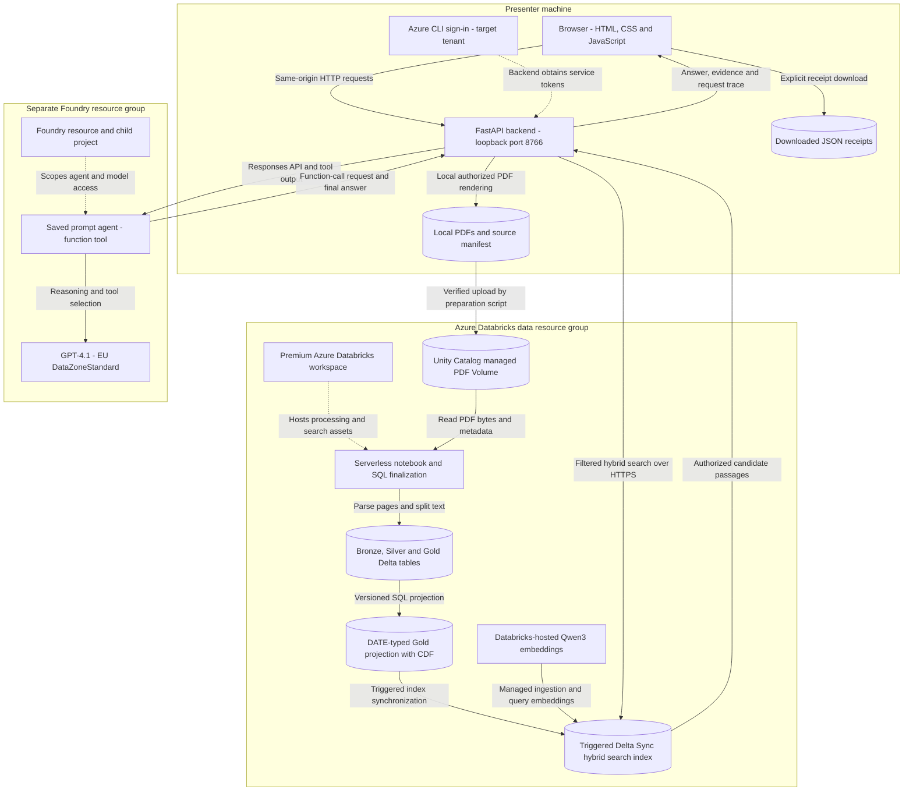
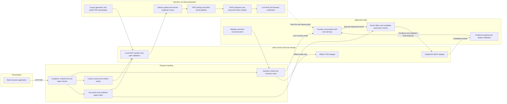

# Architecture Diagram

Implemented Regulatory Research Workbench architecture, documented on 2026-11-12 from the source code and saved live verification evidence. These diagrams describe the current presenter demo, not the production architecture proposed in the original plan.

## Application Architecture

<!-- mermaid-checked: no \n, no em-dash/en-dash, no {} in labels, subgraphs are id["label"], arrows are -->|"label"|, all subgraphs closed by end, ids unique -->

### Technology Stack Summary

| Layer | Technology | Version | Purpose |
| --- | --- | --- | --- |
| Presentation | HTML, CSS, vanilla JavaScript | Repository static assets | Research, corpus, source-page and execution-trace views; no React build in the current demo |
| Local API | Python, FastAPI, Uvicorn | Python 3.13 locally; FastAPI 0.115.5; Uvicorn 0.32.1 | Validation, fixed presenter access context, tool execution, evidence responses and local source serving |
| Authentication | Azure Identity, Azure CLI | azure-identity 1.25.3 | Tenant-scoped developer credentials; no API keys exposed to the browser |
| Agent integration | Azure AI Projects SDK | 2.5.0 | Saved prompt agent and Responses API function-call loop |
| Reasoning | Foundry GPT-4.1 | Model 2025-04-14; DataZoneStandard | Generates the grounded answer from tool evidence |
| Data engineering | Databricks serverless, PySpark, Delta Lake | Managed runtime; not the local Python interpreter | Batch PDF ingestion, parsing, chunking and Delta writes |
| PDF processing | pypdf; LangChain text splitters | Notebook pypdf 6.6.0; splitter 1.1.0 | Page-text extraction and 600-character chunks with 80-character overlap |
| Search | Databricks AI Search and hosted embeddings | Qwen3 embedding endpoint; triggered standard index | Managed embeddings, hybrid retrieval and indexed metadata filters |
| Local source previews | PDFium | pypdfium2 5.14.0 | Renders local PDF pages as PNG images without a browser PDF plugin |
| Offline rehearsal | SQLite FTS5 | Python standard-library SQLite build | Local BM25 retrieval only; not used in live Foundry mode |
| Infrastructure | Azure CLI and Bicep | Version-controlled templates | Isolated workspace and separate Foundry resource/project provisioning |

### Data Storage & External Services

Cloud source PDFs reside in a Unity Catalog managed Volume backed by the Databricks-managed Azure storage account. Parsed pages and chunks reside in managed Delta tables. The current retrieval index is built from a separate DATE-typed projection, not directly from the original text-typed Gold table. Foundry manages the agent conversation created for each question; the application attempts to delete it afterward. The browser's source viewer reads the local PDF copy, not a public Azure blob URL or Foundry file store. JSON receipts are saved locally by explicit scripts or browser downloads.

The live path has no Azure AI Search resource, remote MCP server, APIM, AKS, Container Apps application host, SharePoint connector, SQL source connector or deployed Application Insights exporter. Public BIS publication pages are contacted during corpus download, not on each question.

### Key Architectural Decisions

- Databricks owns document processing, embeddings and retrieval; Foundry owns reasoning and tool selection. The local backend executes the function requested by Foundry and supplies the authorized evidence.
- Tenant, ACL groups and classification permissions come from a server-owned presenter context, never model arguments or a caller-provided identity header. This is demo security trimming, not delegated per-user enterprise authorization.
- The DATE-typed projection/index preserves the required server-side date range filter. The original table/index is retained; projection refresh and triggered synchronization are explicit operations rather than an automatic continuous ingestion system.

## Component Relationships

<!-- mermaid-checked: no \n, no em-dash/en-dash, no {} in labels, subgraphs are id["label"], arrows are -->|"label"|, all subgraphs closed by end, ids unique -->

### Component Inventory

| Component | Layer | Type | Responsibility |
| --- | --- | --- | --- |
| [app/static/app.js](../../../../../app/static/app.js) | Presentation | Browser event handlers | Submits questions, renders safe text, switches views, fetches PDF previews and exports receipts |
| [app/main.py](../../../../../app/main.py) | Request handling | FastAPI application | HTTP boundaries, question validation, mode dispatch, source routes and request-level receipts |
| [app/config.py](../../../../../app/config.py) | Application logic | Configuration | Loads environment values and validates the chosen live-service endpoint configuration |
| [app/contracts.py](../../../../../app/contracts.py) | Application logic | Evidence and access contracts | Builds filters, checks tenant/group/classification/date, maps evidence IDs and validates answer citations |
| [app/cloud.py](../../../../../app/cloud.py) | Application logic and data access | Live adapters | Registers the prompt agent, executes the bounded function loop and queries the configured Databricks index |
| [app/local_search.py](../../../../../app/local_search.py) | Data access | Offline adapter and local file helpers | Parses/caches local evidence, validates paths and provides SQLite FTS5 rehearsal search |
| [app/corpus.py](../../../../../app/corpus.py) | Data preparation | Corpus utility | Creates fictional policies, resolves public PDF downloads and records hashes/provenance |
| [scripts/live_databricks.py](../../../../../scripts/live_databricks.py) | Data preparation | SDK automation | Guards demo ownership, uploads PDFs, adapts a remote notebook copy and runs a bounded serverless task |
| [notebooks/01_databricks_rag.ipynb](../../../../../notebooks/01_databricks_rag.ipynb) | Data preparation | Notebook source | Bronze/Silver/Gold processing and original triggered search-index setup |
| [scripts/finalize_live_index.py](../../../../../scripts/finalize_live_index.py) | Data preparation | SQL/index finalizer | Creates the DATE-typed snapshot and versioned index, stopping the SQL warehouse it starts |
| [scripts/verify_live_rag.py](../../../../../scripts/verify_live_rag.py) | Verification | Live integration check | Verifies readiness, filtered results, denial cases and a real grounded Foundry tool call |
| [scripts/browser_smoke.py](../../../../../scripts/browser_smoke.py) | Verification | Playwright browser check | Exercises desktop/mobile research, sources and receipts; cloud calls require explicit opt-in |

For detailed user actions, numbered data/request steps, resource names and security limitations, see [the solution walkthrough](../../../../../docs/architecture.md).